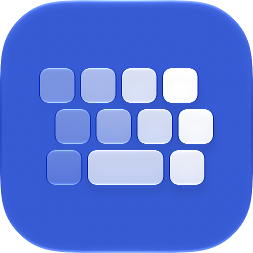
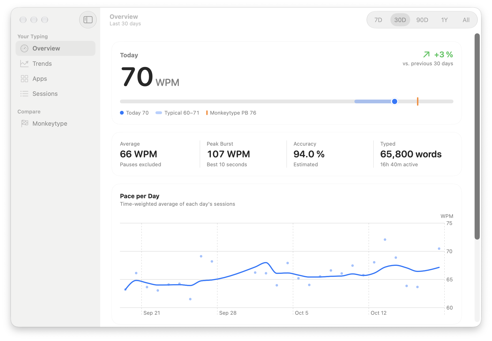
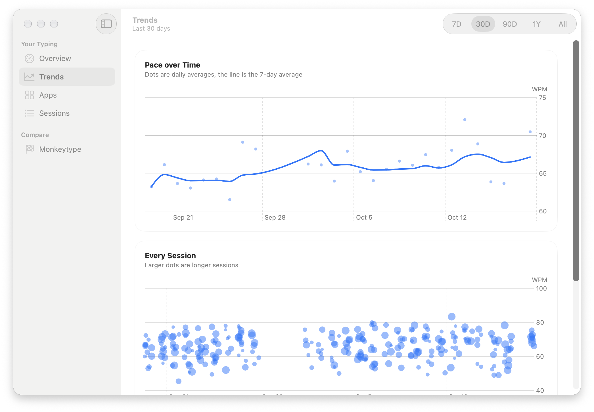
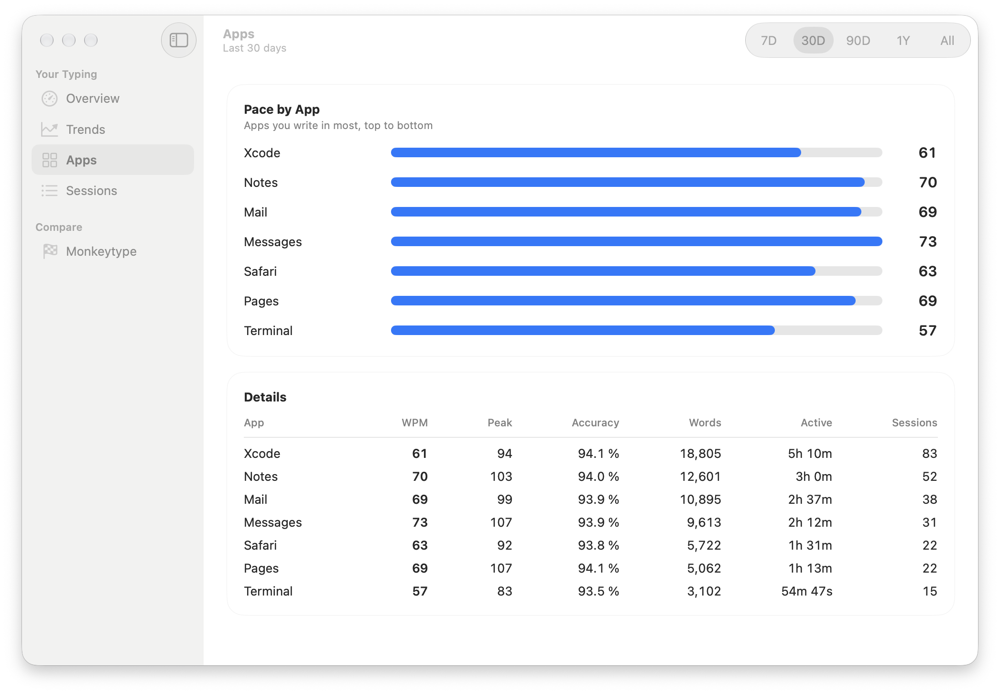
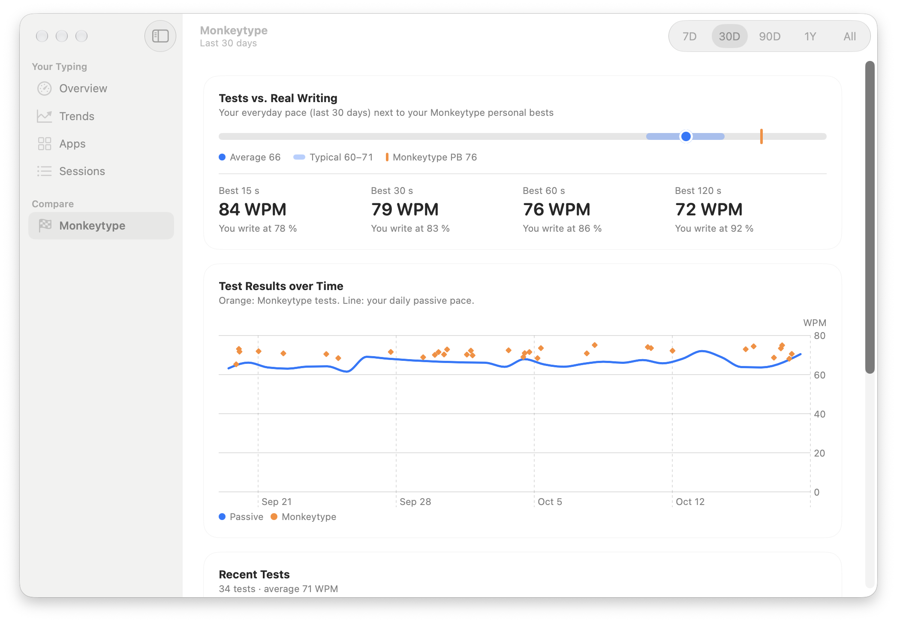
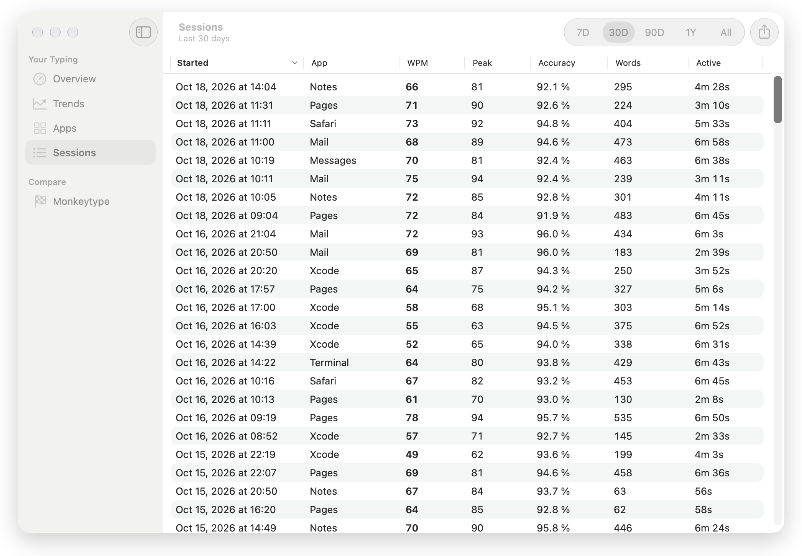
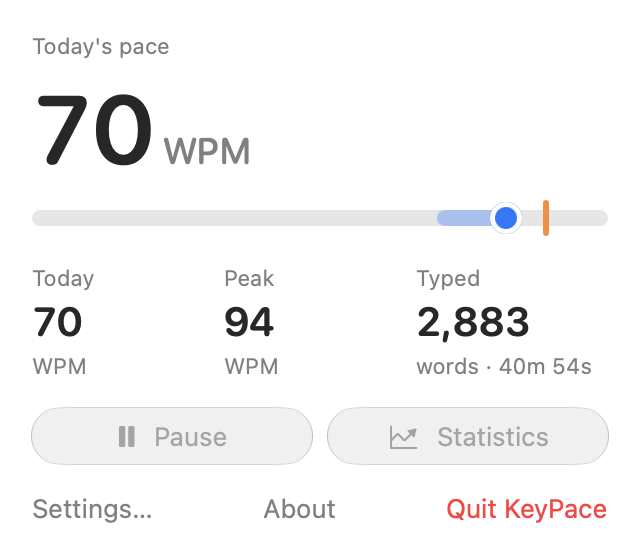

<p align="center">
  
</p>

<h1 align="center">KeyPace</h1>

<p align="center"><b>Your real typing speed, measured while you work.</b></p>

> [!NOTE]
> This app was vibe coded: written with an AI coding assistant ([Claude Code](https://claude.com/claude-code)),
> with me directing, testing and using it day to day.

KeyPace is a native macOS menu bar app that measures how fast you type in any app (your editor,
terminal, mail or chat) without taking typing tests. It keeps a history, so you can see how
your everyday speed changes over days and months, and it compares that with your
[Monkeytype](https://monkeytype.com) results if you connect an account.

It counts keystrokes only. The text you type is never read, stored or sent anywhere.

<p align="center">
  
</p>

## Screenshots

<table>
  <tr>
    <td width="50%"></td>
    <td width="50%"></td>
  </tr>
  <tr>
    <td align="center"><b>Trends</b>: daily pace and every session</td>
    <td align="center"><b>Apps</b>: where you type fastest</td>
  </tr>
  <tr>
    <td width="50%"></td>
    <td width="50%"></td>
  </tr>
  <tr>
    <td align="center"><b>Monkeytype</b>: tests compared with real writing</td>
    <td align="center"><b>Sessions</b>: every session, exportable as CSV</td>
  </tr>
</table>

<p align="center">
  <br>
  <b>Menu bar</b>: live pace while you type
</p>

<sub>Screenshots use made-up demo data.</sub>

## Features

- **Measures in the background:** a listen-only keyboard tap counts characters and
  backspaces in whatever app is in front.
- **Live speed in the menu bar** while you type, plus today's average, peak burst and amount typed.
- **Statistics window** (Liquid Glass, macOS 26+):
  - **Overview:** today against your typical range, a daily pace chart, speed by hour of day and top apps.
  - **Trends:** your speed over 7 days, 30 days, 90 days, 1 year or all time.
  - **Apps:** speed, accuracy and amount typed per app.
  - **Sessions:** a sortable table of every session, with delete and CSV export.
- **Monkeytype comparison:** imports your test results and personal bests (read-only ApeKey)
  and charts them next to your passive speed.
- **WPM or BPM:** words per minute (5 characters = 1 word, like Monkeytype) or characters
  per minute (*Anschläge pro Minute*).
- **Privacy controls:** pause tracking, exclude apps (password managers are excluded by
  default), export or delete all data.
- **Launch at login**, a Dock menu, keyboard shortcuts, and light, dark and tinted appearances.

## Install

Requires **macOS 26 (Tahoe) or later**, on Apple silicon or Intel.

1. Download **KeyPace-x.y.zip** from the [latest release](https://github.com/kaichn/keypace/releases/latest).
2. Unzip it and move **KeyPace.app** to your **Applications** folder.
3. Open it. macOS shows *"KeyPace" Not Opened*, because the app isn't notarized by Apple
   (that needs a paid developer account). Click **Done**, then:
   - Open System Settings → **Privacy & Security**, scroll down to the message about KeyPace,
     click **Open Anyway** and confirm with your password.
   - Or, in Terminal: `xattr -dr com.apple.quarantine /Applications/KeyPace.app`

   You only have to do this once. Updates are signed with the same certificate, so macOS
   keeps your permissions.

To check a download, compare `shasum -a 256 KeyPace-x.y.zip` with the `.sha256` file on
the release page.

### First launch

1. Click the KeyPace icon in the menu bar, then **Grant Access**.
2. In System Settings → Privacy & Security → **Input Monitoring**, turn on KeyPace.
3. Start typing anywhere. Tracking starts within a second, without a relaunch.

## Build from source

Needs Xcode 26 or later, selected with `sudo xcode-select -s /Applications/Xcode.app`. The
Command Line Tools alone are not enough: the icon is compiled with `actool`.

```sh
git clone https://github.com/kaichn/keypace.git && cd keypace
./scripts/make-signing-cert.sh   # optional, once (see below)
./build.sh install               # tests, builds, copies to /Applications and launches
```

| Command | Result |
| --- | --- |
| `./build.sh` | Runs the tests and builds `build/KeyPace.app` |
| `./build.sh install` | Also replaces `/Applications/KeyPace.app` and launches it |
| `./build.sh release` | Universal build (Apple silicon + Intel), zipped as `dist/KeyPace-<version>.zip` with a SHA-256 checksum |
| `SKIP_TESTS=1 ./build.sh` | Skips the tests |
| `swift test` | Runs the tests only |

### Signing certificate (optional)

macOS ties the Input Monitoring permission and Keychain access to the app's signature. An
ad-hoc signature changes with every build, so after each rebuild macOS would ask again.
`scripts/make-signing-cert.sh` creates a self-signed certificate called
**KeyPace Local Signing** in your login Keychain. `build.sh` signs with it automatically when
it exists and signs ad-hoc when it doesn't. To remove it later, open Keychain Access → login →
My Certificates and delete it.

## How speed is measured

| Term | Definition |
| --- | --- |
| **Net characters** | Characters typed minus backspaces. Each backspace removes one character. |
| **Active time** | Time spent typing. Gaps longer than the pause threshold (default 2 s) count as thinking time and are left out. |
| **Speed (WPM)** | Net characters ÷ 5 per active minute, the same definition Monkeytype uses. BPM = WPM × 5. |
| **Peak burst** | The most net characters in any 10 seconds of active time. |
| **Accuracy (est.)** | The share of keystrokes that weren't deleted again. |
| **Session** | Continuous typing in one app. It ends when you switch apps, the Mac sleeps, or you stop typing for the idle timeout (default 20 s). A session needs at least 30 net characters and 5 seconds of typing. |
| **Short bursts** | Typing too short to save on its own, like a Spotlight search or a quick reply, is pooled per app during the day and saved as one session once it adds up. Only typing time counts, never the gaps between bursts. |
| **App** | The app that receives the keys, even when it isn't the frontmost app. Typing in Spotlight counts for Spotlight (shown as *Siri AI* on macOS versions where Siri AI draws the search panel), not for the app behind it. |
| **Averages** | Weighted by typing time, so a 20-minute session counts more than a 20-second one. |

**What counts:** letters, digits, punctuation, space and Return.<br>
**What's ignored:** shortcuts with ⌘ or ⌃, arrow and function keys, Tab, Esc, and held-down
(auto-repeating) letters. Password fields can't be seen at all, because macOS Secure Input
hides them from every keyboard tap.

These definitions are covered by tests in `Tests/KeyPaceTests/SpeedMathTests.swift`.

## Monkeytype

Monkeytype's public API is read-only. With an ApeKey you can download results and personal
bests, but no endpoint accepts uploads. Saving a result needs the signed-in web client and its
anti-cheat checks. So KeyPace imports your tests rather than syncing passive sessions to
Monkeytype.

1. On monkeytype.com, go to Account settings → Ape keys, create a key and **activate** it.
2. In KeyPace, open Statistics → Monkeytype and paste the key.

The key is stored in your login Keychain. ApeKeys may fetch results only 30 times a day, so
KeyPace syncs automatically at most every 6 hours (or when you click **Sync Now**).

## Privacy

- KeyPace only sees key-down events, sorts each one into *character* or *backspace*, and throws
  it away. It stores counts and timestamps, never keys or text.
- No network access except to `api.monkeytype.com`, and only when you've connected an ApeKey.
- Data stays on your Mac:
  - `~/Library/Application Support/KeyPace/keypace.sqlite`: sessions
  - `~/Library/Application Support/KeyPace/monkeytype.json`: imported Monkeytype data
- Export everything as CSV (⇧⌘E), or delete it in Settings → Privacy & Data.

## Project layout

```
Sources/KeyPace/
  KeyPaceApp.swift      App, menu bar extra, windows and menu commands
  KeyMonitor.swift      CGEventTap and key classification
  LiveSession.swift     Speed maths for the session being typed
  AppModel.swift        App state: sessions, permission, pause, app switching
  Models.swift          TypingSession, aggregates, units, preferences
  Store.swift           SQLite storage
  Monkeytype.swift      ApeKey API client, cache and Keychain
  StatsView.swift       Statistics window (Overview, Trends, Apps, Sessions)
  MonkeytypePane.swift  Monkeytype comparison
  MenuBarView.swift     Menu bar popover
  SettingsView.swift    Settings window
  StatsWindow.swift     Window and Dock behaviour, app delegate
  Design.swift          Shared components (cards, pace band, numerals)
Tests/KeyPaceTests/     Swift Testing suite
Resources/
  Info.plist
  AppIcon.icon/         Icon Composer document (layered Liquid Glass icon)
scripts/
  make-signing-cert.sh  Optional local signing certificate
  make-icon-layers.py   Regenerates the icon's keycap layers
docs/                   README icon and screenshots
build.sh                Test, build, bundle, sign, install, package releases
```

### Build notes

- The app is a plain SwiftPM package. `build.sh` turns it into a `.app` bundle, so no Xcode
  project is needed. To work in Xcode, open `Package.swift`.
- **SDK stamp:** SwiftPM writes the deployment target (26.0) into the binary where the SDK
  version belongs. macOS uses that field to decide whether to show the new design, so
  `build.sh` stamps the real SDK version with `vtool`. It stops with an error if the
  result is below 26, which would run the app in compatibility mode without Liquid Glass.
- **App icon:** `Resources/AppIcon.icon` can be edited in Icon Composer (Xcode → Open Developer
  Tool). The system renders the glass lighting and the dark, clear and tinted variants.
- **Separate data folder:** `KEYPACE_DATA_DIR=/some/dir build/KeyPace.app/Contents/MacOS/KeyPace`
  runs the app against a different folder, leaving your real data alone. Quit the
  installed copy first, or both will record your typing.

## License

[MIT](LICENSE)
